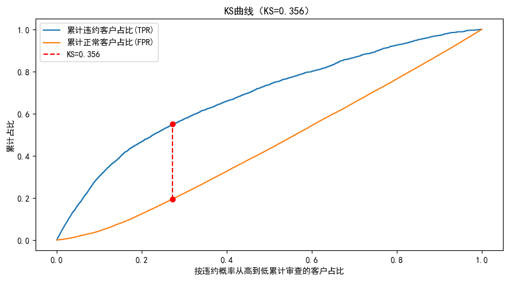
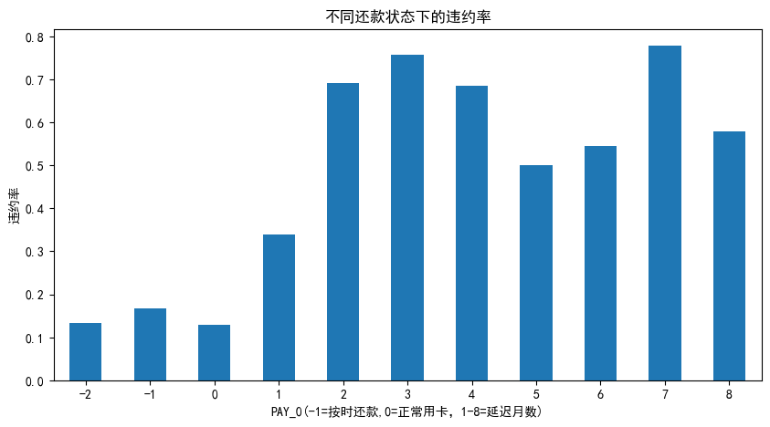
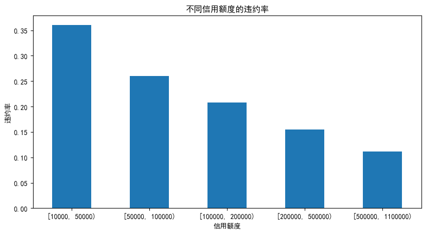

# 信用卡客户违约预测分析

基于 UCI 公开的台湾信用卡客户数据集（3 万条记录、25 个字段），完成数据清洗、探索性分析、特征工程和违约预测建模，最后将模型分数落地为一个审批策略模拟。

## 数据说明

- 来源：UCI「Default of Credit Card Clients」公开数据集（在 UCI 官网搜索下载）
- 规模：30,000 条客户记录，25 个字段（信用额度、人口属性、近 6 个月还款状态 / 账单金额 / 还款金额）
- 预测目标：客户下月是否违约（违约率 22.1%）

## 分析流程

1. **数据清洗**：修正 EDUCATION（0/5/6→4）、MARRIAGE（0→3）中数据字典外的脏值；核查年龄区间与账单负数（退款/溢缴款）的业务含义
2. **探索分析**：还款状态、年龄、信用额度与违约率的关系
3. **特征工程**：构造还款率（BILL_RATE）、额度使用率（UTIL_RATE），并验证其与违约率的关系
4. **建模**：逻辑回归+ 随机森林；分层抽样切分训练/测试集，标准化后重新训练
5. **评估**：对比逻辑回归（AUC 0.713）与随机森林（AUC 0.735），差距仅 0.02，基于可解释性选型逻辑回归
             KS = 0.360
6. **业务落地**：模拟「拒绝违约分数最高的 30% 申请者」的审批策略

## 核心结论

- 上月还款状态是最强预测信号：逾期 2 个月的客户违约率 69%，逾期 3 个月 76%，而按时还款客户仅约 13%~17%
- 信用额度与违约率单调负相关：额度越低，违约率越高
- 违约客户占用的额度更高，资金压力大，易违约
- 策略模拟：拒绝分数最高的 30% 申请者后，剩余客户坏账率从 22.1% 降至 13.4%，坏账风险下降 39.2%

## 核心图表

-  —— KS 曲线：两条曲线的最大差距就是 KS，可以衡量模型区分好坏客户的能力
-  —— 不同还款状态下的违约率
-  —— 不同信用额度下的违约率

## 运行环境

Python 3.13 / pandas / numpy / scikit-learn / matplotlib / seaborn

## 写在最后

这是我第一个从头到尾做完的建模项目。中间出现了不少问题，或是理解不清楚每个字段的含义需要反复看字段说明，亦或建模出现警告信息，都需要反复查资料，调试代码。但这期间也学到了不少东西，大家总是在不断试错与解决问题的过程中成长的。

